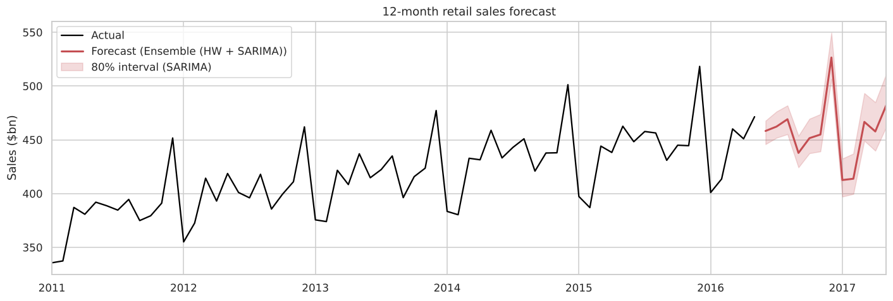
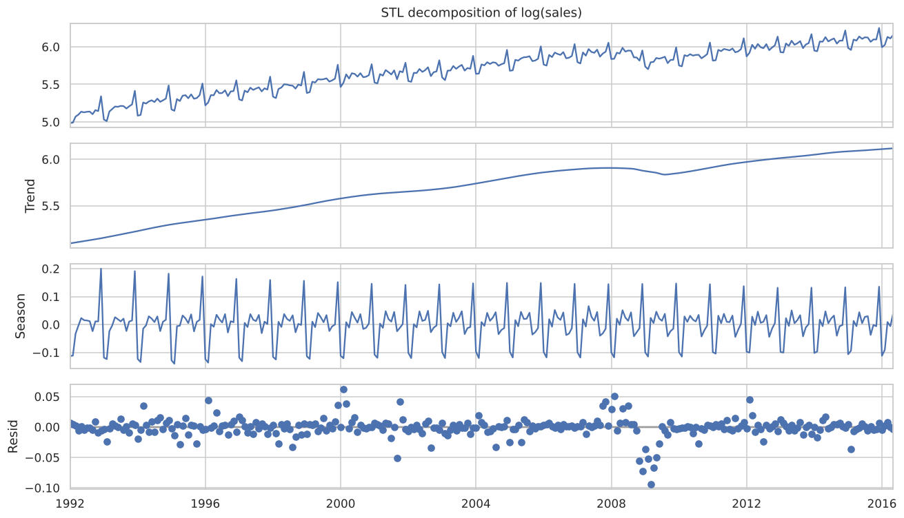
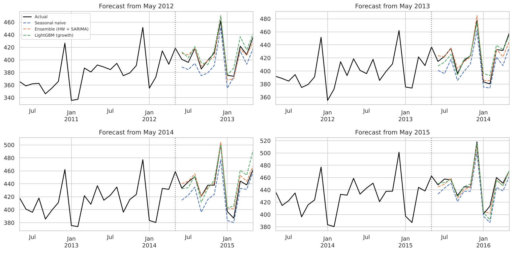

# US Retail Sales Forecasting

Forecasting monthly US retail sales 12 months ahead with classical time series models and machine learning, evaluated with a rolling-origin backtest over four separate years.



## The data

Monthly US retail sales from the US Census Bureau, January 1992 to May 2016 (293 months, not seasonally adjusted). The CSV is the one shipped with [Prophet's examples](https://github.com/facebook/prophet/tree/main/examples) and is included in `data/`.



What the decomposition shows:
- A very strong upward trend (strength 1.00), with one big break during the 2008-09 financial crisis
- Strong **multiplicative** seasonality (strength 0.94): December runs about **16% above trend**, and January/February about 10-11% below
- Seasonal swings that grow with the level, so I model in logs or use multiplicative seasonality

## Models

| Model | Idea |
|---|---|
| Seasonal naive | "Same month last year", the baseline to beat |
| Holt-Winters | Exponential smoothing with damped trend and multiplicative seasonality |
| SARIMA (2,1,1)(1,1,1)12 | Order picked by AIC from a grid, fitted on log sales |
| LightGBM | Predicts year-over-year **growth rate** from lagged growth and the month, then forecasts recursively. Trees can't extrapolate a trend, so they model growth instead of the level. |
| Ensemble | Average of Holt-Winters and SARIMA |

## Evaluation: rolling-origin backtest

A single train/test split can make a model look good or bad by luck. Instead I simulated forecasting from **May 2012, 2013, 2014 and 2015**. Each time, the models are trained only on data up to that point and forecast the next 12 months.

| Model | MAPE | RMSE ($bn) | MASE |
|---|---|---|---|
| **Ensemble (HW + SARIMA)** | **1.19%** | **6.24** | **0.32** |
| SARIMA | 1.21% | 6.33 | 0.33 |
| Holt-Winters | 1.41% | 7.40 | 0.39 |
| LightGBM (growth) | 1.67% | 9.07 | 0.45 |
| Seasonal naive | 3.29% | 15.47 | 0.91 |



**Key results**
- The ensemble cuts forecast error by **64%** compared to the seasonal naive baseline.
- Combining two good models beat either one alone.
- On a single, regular monthly series, **classical models beat LightGBM**. It's always worth checking a simple model before reaching for a complex one.
- The SARIMA 80% prediction intervals covered **100%** of backtest months, so they're too wide. The 2008 crash in the training data inflates the estimated uncertainty. I note this in the notebook instead of presenting it as a win.

The final 12-month forecast with intervals is in `results/forecast_2016_2017.csv`.

## Run it

```bash
pip install -r requirements.txt
jupyter notebook sales_forecasting.ipynb
```

## Limitations

None of these models can see a shock like 2008 or 2020 coming. A real planning process would pair this baseline forecast with downside scenarios.
